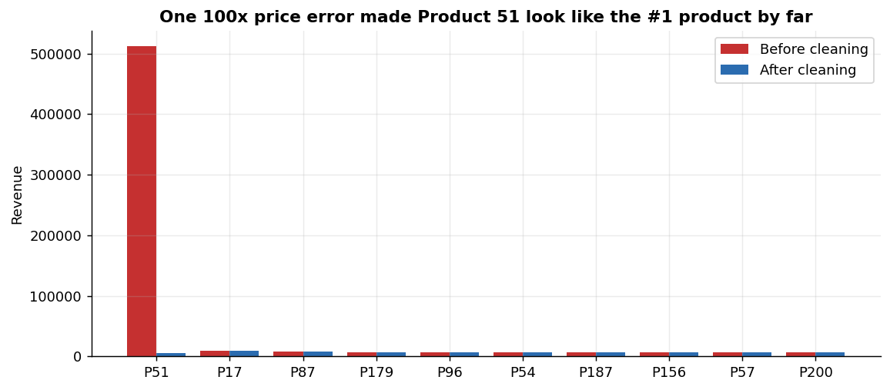
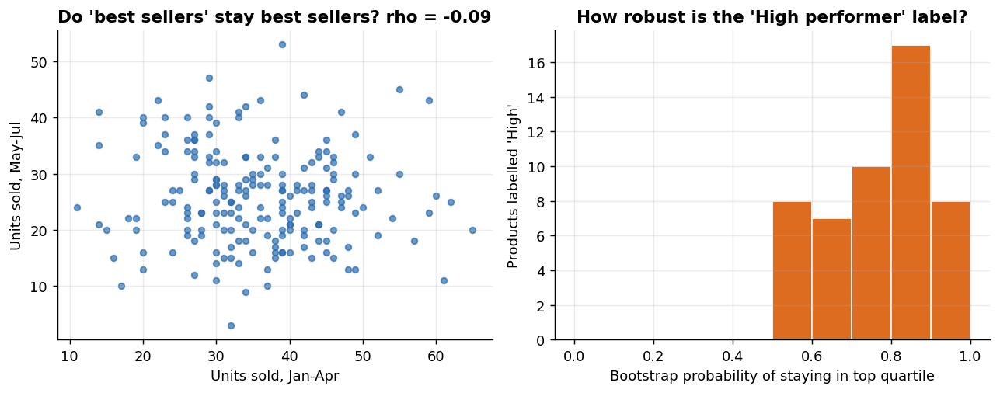
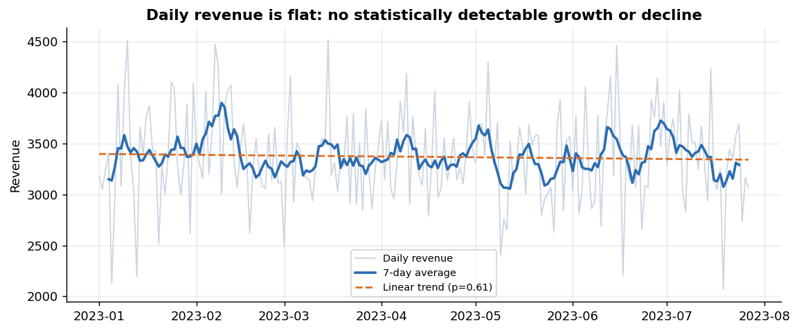
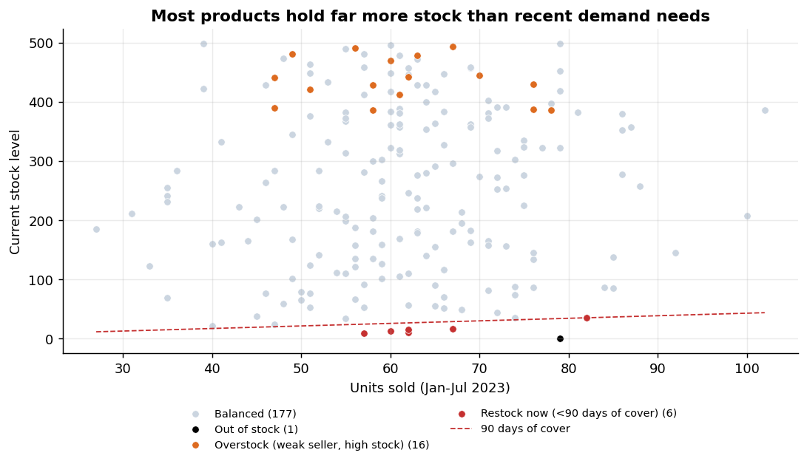
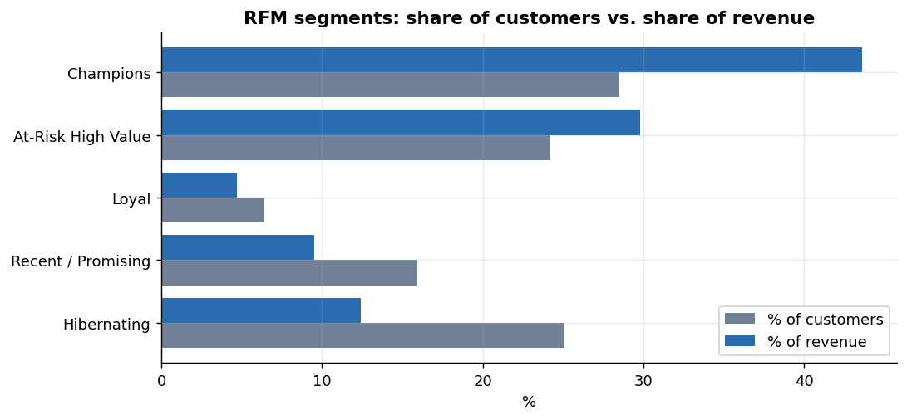
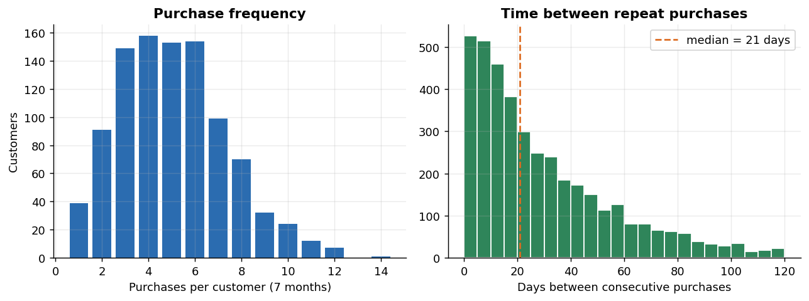

# Retail Analytics: Product Performance, Customer Segmentation & Behaviour (SQL + Python)

An end-to-end analysis of a retail dataset (5,000 transactions, 1,000 customers, 200 products, Jan–Jul 2023).
**SQL does the heavy lifting** (data quality audit, cleaning, KPIs, RFM segmentation, behaviour metrics);
**Python** is used for statistical testing, a bootstrap robustness check, k-means validation and charts.

The distinguishing feature of this project is that every pattern is **stress-tested before it is believed**: several
"obvious" conclusions turned out to be artefacts of a data error, of price, or of random noise (see [Key findings](#key-findings)).

> **Scope note.** This is a guided case study built on supplied datasets. The data shows strong signs of being
> synthetic (see [Limitations](#limitations--what-this-analysis-cannot-tell-you)), so findings describe *this dataset*
> and should not be read as claims about a real company.

---

## Business problem

A retail company sees stagnant growth and declining engagement. Three questions:

| # | Question | Where answered |
|---|----------|----------------|
| 1 | Which products perform well / poorly, and what does that mean for inventory and marketing? | `sql/04_product_performance.sql` |
| 2 | Can customers be segmented by purchasing behaviour for targeted marketing? | `sql/05_customer_segmentation.sql` |
| 3 | What do repeat-purchase and loyalty patterns look like? | `sql/06_customer_behavior.sql` |

---

## Key findings

**1. A single data error inflated revenue by 72%.**
All 20 sales rows for Product 51 are recorded at 9,312 instead of the catalogue price 93.12 (exactly 100×, a decimal shift).
Left uncorrected, Product 51 appears to be the #1 product with 512,160 in revenue, and total revenue reads 1,209,042 instead of the true **702,004**.
After correction it ranks **#48**. Every other row (4,982) matches the catalogue exactly, which is why catalogue price was used.



**2. "Top-selling" products are mostly just expensive products, not more popular ones.**
Product revenue correlates almost perfectly with price (Spearman ρ = 0.92), while *units sold* is unrelated to price (ρ = 0.006).
Units sold per product is statistically indistinguishable from "every product equally likely" (χ² p = 0.75), and a product's unit rank in Jan–Apr does **not**
predict its rank in May–Jul (ρ = −0.09, p = 0.23). Practical meaning: revenue ranks are stable, but only because prices are stable.
Treating the top revenue quartile as "high demand" would be a mistake. Demand differences between products are not detectable here.



**3. Growth is flat, but "declining engagement" is not supported.**
The data contains exactly 24 transactions on every complete day. Daily revenue has no trend (−0.24% per 30 days, p = 0.61).
Active customers (roughly 470–520 per month; July is a partial month) and month-to-month retention (48–53%) are stable. The data supports "stagnant", not "declining".



**4. Inventory is badly out of line with sales, and it is the most actionable finding.**
Total stock is 51,836 units against 12,325 units sold in 209 days (median product: ~880 days of cover).
- **7 products need restocking now** (<90 days of cover), one of which (Product_93, 79 units sold) is **out of stock**.
- **16 weak-selling products tie up 6,984 units** of stock while generating 2.5% of revenue (median cover ~1,540 days).



**5. Behavioural (RFM) segments are useful; demographics are not.**
Age, gender, location and tenure have no detectable relationship with spend (all p ≥ 0.12, effect sizes ≈ 0).
Behaviour does separate customers:

| Segment | Customers | % of customers | % of revenue | Avg recency (days) | Avg purchases |
|---|---|---|---|---|---|
| Champions | 282 | 28.5% | 43.6% | 14 | 7.2 |
| **At-Risk High Value** | 239 | 24.2% | **29.8%** | 60 | 6.0 |
| Loyal | 63 | 6.4% | 4.7% | 13 | 5.6 |
| Recent / Promising | 157 | 15.9% | 9.5% | 15 | 3.1 |
| Hibernating | 248 | 25.1% | 12.4% | 83 | 2.8 |

The **At-Risk High Value** group (~209k revenue) is the clear win-back target: heavy buyers silent for 32–155 days when the typical gap between a customer's purchases is
21 days (75th percentile 44, 90th percentile 71).



**6. Repeat purchasing is very high.** 96.1% of purchasing customers bought more than once (avg 5.1 purchases, median 21 days between purchases).
Customers who shop in more categories spend more in total, but this is almost entirely because they buy more often
(revenue per purchase is ~124 for 1-category customers vs ~140 for everyone else).



---

## Recommendations

1. **Fix the data pipeline first.** Add a validation rule that rejects or flags any sale whose price deviates from catalogue by more than a tolerance, and enforce unique transaction IDs. One bad product distorted revenue by 72%.
2. **Inventory:** restock the 7 low-cover products (`outputs/tables/restock_priority_list.csv`); pause re-orders and consider clearance for the 16 overstock products (`overstock_list.csv`). **Before** acting on the company-wide overstock, verify what `StockLevel` represents (see limitations).
3. **Marketing:** run a win-back campaign on the 239 At-Risk High Value customers, triggered around 45 days of inactivity (≈ 75th percentile of the normal purchase gap). Reward Champions with loyalty perks rather than discounts, since they already buy at high frequency.
4. **Do not target by demographics**; there is no evidence it would help. Use behaviour.
5. **Test, don't assume, product demand.** Because unit demand differences are not distinguishable from chance, a randomised promotion test (e.g. promote half of similarly priced products) is the way to learn what truly drives demand.
6. **Growth lever:** volume is fixed at 24 transactions/day and basket size is flat, so growth must come from more transactions (acquisition, win-back) or larger baskets, not from re-ranking products.

---

## Methodology

### Data cleaning (all in `sql/02_data_cleaning.sql`; raw tables are never modified)

| Issue found | Rows | Treatment | Why |
|---|---|---|---|
| Exact duplicate transactions (IDs 4999, 5000) | 2 | Removed with `SELECT DISTINCT` | Identical in every column |
| Product 51 price = 100× catalogue | 20 | Used catalogue price | 4,982 other rows match the catalogue exactly; ratio is exactly 100.0 → decimal-shift error. *Assumption: the catalogue is right.* |
| Missing `Location` | 13 | Labelled `Unknown` | Keeps the customer; avoids guessing |
| Age = 131 | 1 | Age set to `NULL` | Impossible value; not replaced with an imputed guess |
| Dates stored as text `dd/mm/yy` | all | Converted to ISO `yyyy-mm-dd` | Parsing as `mm/dd` fails on 2,986 of 5,002 rows, so `dd/mm` is confirmed |
| Last day (28-Jul) only partly recorded | 1 day | Excluded from per-day metrics and the trend test | Only 8 of the usual 24 transactions; including it would bias the trend downward |
| Product 93 has zero stock | 1 | Flagged `Out of stock` | Real operational issue, not an error |

Integrity checks passed: no orphan customer or product IDs, no non-positive quantities or prices, no transactions before the customer's join date.

### Analytical choices worth knowing

- **RFM scoring uses `CUME_DIST`, not `NTILE`.** `NTILE` splits tied values arbitrarily (customers with the same purchase count could land in different quartiles). `CUME_DIST` gives equal values equal scores.
- **Restock flag uses days of cover, not revenue rank.** An early version used revenue quartiles. It flagged products with 500 days of stock as "priority" and missed a cheap product with 33 days left. Stock-outs are driven by *units* demand.
- **Multiple testing:** 17 hypothesis tests were run, so p-values are Holm-adjusted (`outputs/tables/statistical_tests.csv`).
- **Segments validated with k-means:** silhouette scores are only 0.34–0.38 (k = 2–5), and agreement with the rule-based segments is modest (adjusted Rand index 0.28 at k = 5). Customers form a **continuum, not natural clusters**. The RFM segments are a useful, interpretable business partition, not a discovered structure.
- **Bootstrap check (2,000 resamples):** the "High performer" (top revenue quartile) label holds with mean probability 0.77; the "Low performer" label with 0.87. Robust to sampling noise, but, per finding 2, mostly because these are price tiers.

---

## Limitations & what this analysis cannot tell you

- **The data looks synthetic:** exactly 24 transactions every day; join dates strictly increase with customer ID, evenly spaced 1–2 days apart; quantities are roughly uniform on 1–4; unit demand is uncorrelated with price and indistinguishable from equal popularity; purchases per customer are only slightly more spread out than pure chance (variance/mean = 1.13). Real retail data rarely looks like this, so treat conclusions as illustrations of method.
- **No cost or margin data**, so "high performer" means revenue, not profit.
- **Currency not specified**; figures are shown as plain numbers.
- **Only 7 months**, no prior year: seasonality and year-over-year growth cannot be assessed. "Past quarters" in the brief cannot be fully checked.
- **`StockLevel` has no timestamp or definition.** The ~880-day median cover suggests either genuine overstock or that sales are a sample of total volume; this must be verified with the business.
- **Product 51's correction is an assumption.** If its true price were 9,312, it really would be the top product. The evidence (exactly 100× the catalogue; all other rows match) makes a recording error far more likely, but it should be confirmed with the data owner.
- **RFM thresholds are relative** (quartiles of this customer base); segment sizes will shift if the cut-offs change.

---

## Repository structure

```
├── data/raw/                  # the 3 source CSVs (unchanged)
├── sql/
│   ├── 01_data_quality_checks.sql
│   ├── 02_data_cleaning.sql
│   ├── 03_eda.sql
│   ├── 04_product_performance.sql
│   ├── 05_customer_segmentation.sql
│   └── 06_customer_behavior.sql
├── src/run_pipeline.py        # loads data, runs SQL, statistical tests, charts
├── outputs/
│   ├── tables/                # every query result as CSV (incl. statistical_tests.csv)
│   └── figures/               # 8 charts
├── requirements.txt
└── README.md
```

## How to reproduce

```bash
git clone https://github.com/<your-username>/retail-analytics-sql.git
cd retail-analytics-sql
python -m venv .venv && source .venv/bin/activate     # Windows: .venv\Scripts\activate
pip install -r requirements.txt
python src/run_pipeline.py
```

Runs in a few seconds. SQLite is bundled with Python, so no database server is needed. The SQL is standard enough
(window functions, CTEs) to port to PostgreSQL or MySQL with small changes to date functions.

## Tools

SQL (SQLite: CTEs, window functions `RANK`, `NTILE`, `CUME_DIST`, `LAG`), Python (pandas, SciPy, scikit-learn, Matplotlib).
